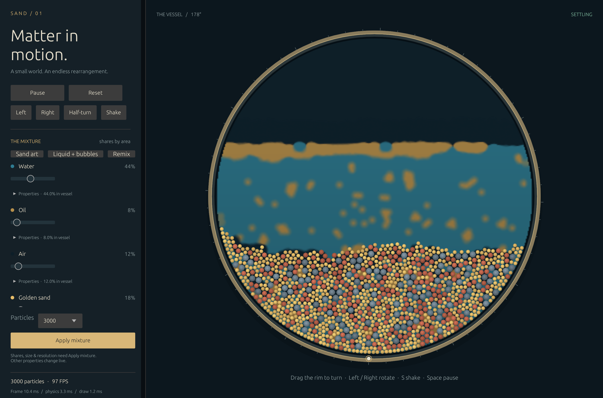
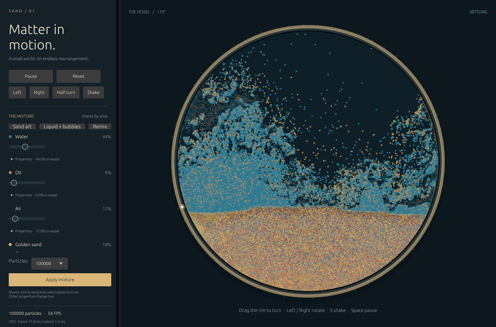
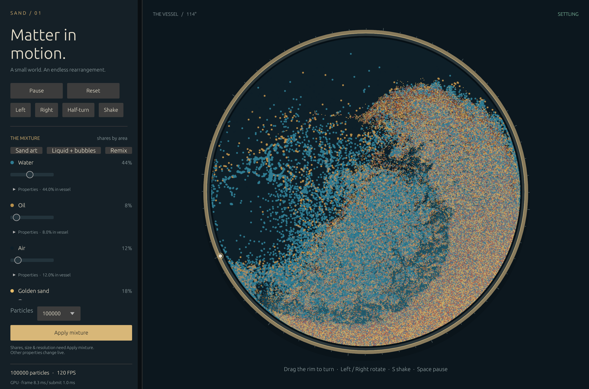

# Measured performance

The CPU measurements below are retained as history. The latest GPU 100,000-particle measurements are recorded at the end; earlier CPU and two-iteration GPU figures do not describe the final GPU solver.

Measured 2026-11-09 on this development machine: macOS / Apple Silicon (aarch64), Rust 1.90.0, Bevy 0.14.2. Results describe this host under its current load. The application uses a release build, a 1/120-second fixed step and two constraint iterations. The default window is 1360 × 900 logical pixels; the captured Retina render is 2720 × 1800.

## Default application

The final 1,800-frame scripted windowed run used **3,000 particles** and exercised rotation, shaking and pause/resume. After startup warm-up, its 1,650 nonpaused timing samples measured:

- Median frame: **8.319 ms / 120.2 FPS**.
- 95th-percentile frame: **10.216 ms**.
- Median physics time per displayed frame: **2.858 ms**. This run often displayed 120 frames/second; do not compare this number directly with the two-step 60 Hz solver benchmark below.
- Simulated time: 14.858 seconds. Cumulative lost simulation time: 0.058 seconds, including initial stalls; deliberately paused time is excluded by the clock.
- All particles finite and contained, with the original 3,000 count preserved.

The default meets the proposed 60 FPS target in this run. Live timing now uses Bevy's **real** clock; its capped virtual clock would hide part of a long stall. The real-clock integration regression covers a full one-second frame.

A second 900-frame windowed run at **6,000 particles** measured 750 nonpaused samples: median **16.946 ms / 59.0 FPS**, p95 **23.789 ms**, physics median **13.181 ms** per displayed frame, and 0.050 seconds lost simulation time. It stayed finite and contained. This is a borderline setting on this host, with visible frame-time variation; it is not the 60 FPS default.

## Headless scaling

Each row measures **two fixed steps**, equivalent to 1/60 second of simulated time, without rendering. Each workload starts fresh and warms up for 120 frame-equivalents. 1,500 / 3,000 / 6,000 measure 600 frame-equivalents per workload; 12,000 is a shorter 120-frame scaling probe. These were run sequentially, after the app test.

| Particles | Workload | Median ms | p95 ms | Max ms |
| ---: | :--- | ---: | ---: | ---: |
| 1500 | settling | 2.345 | 2.674 | 3.150 |
| 1500 | rotation | 2.551 | 2.742 | 2.991 |
| 1500 | shaking | 2.624 | 2.953 | 4.156 |
| 3000 | settling | 5.825 | 6.297 | 7.137 |
| 3000 | rotation | 5.497 | 5.764 | 6.187 |
| 3000 | shaking | 5.894 | 6.476 | 11.306 |
| 6000 | settling | 13.495 | 14.139 | 14.770 |
| 6000 | rotation | 12.387 | 13.106 | 21.932 |
| 6000 | shaking | 13.531 | 14.469 | 15.539 |
| 12000 | settling | 32.051 | 33.404 | 34.909 |
| 12000 | rotation | 27.718 | 29.075 | 32.604 |
| 12000 | shaking | 30.786 | 32.503 | 33.703 |

At **3,000**, all three workloads meet the proposed median <8 ms and p95 <12 ms physics budgets. **6,000** takes roughly 12.4–13.5 ms of physics per 60 Hz frame-equivalent and leaves a narrow rendering budget. **12,000** takes 27.7–32.1 ms before drawing and is not a real-time 60 Hz setting on this CPU implementation. 24,000 is selectable for exploration but was not benchmarked here; no frame-rate claim is made for it.

Particle count and mixture remain unchanged when the app slows down. At most four fixed steps run per displayed frame; the app reports lost simulation time when that cannot maintain wall-clock progression. Color-field texture resolution and draw batching stay bounded; the CPU neighbor/constraint solve is the present scaling limit. Parallel/GPU physics is the next substantial scaling step, rather than adding one ECS entity per particle.

## Checks and limitations

- 22 behavior tests passed: recipe validation/area allocation, seed reproducibility, containment/count conservation, density contrast and dense settling, frictional settling, zero-distance contacts, pause/catch-up timing, offset/scaled coordinate mapping, transactional Apply/Reset, exact bounded half-turn braking, real-clock stall reporting and visible gas color.
- Formatting, full release tests and all-target compilation passed.
- An independent review found the clock, turn and gas-color issues; each has a regression observed failing before its fix and the final suite is green.
- The rendered final frame was visually inspected for coherent liquid regions, visible grains and frame orientation. The scripted run drives the same bounded rotation/shake/clock paths as the controls.
- Native mouse-event automation and live window resizing were not exercised. Geometry mapping is covered in unit tests; visual inspection used the normal desktop window size.
- This is an approximate 2D physical toy, not a calibrated multiphase CFD model. Bounded correction/acceleration clamps intentionally trade exact conservation and incompressibility for interactive stability.

Raw results are in [benchmarks](benchmarks/). The reproducible commands and controls are in the [README](../README.md).

## Follow-up: grain-contact correction

The corrected solver removes three sources of artificial sticking: friction across a gap, solid-to-solid viscous coupling, and negative fluid pressure pulling grains together. Friction is now bounded by actual compressive contact load. No material friction defaults were reduced to conceal these causes.

The full release suite now passes **27 tests**, including five additional grain cases: unloaded gap, barely loaded contact, noncontact dry viscosity, loaded-contact friction, and isolated fluid-mediated attraction. The four defect cases were observed failing before their fixes; the loaded-contact guard verifies that sand still has friction under load. Formatting and all-target compilation also pass. A focused independent review approved the contact-load accounting and identified no new actionable issue; it also confirmed the tensile fluid-pressure path.

A fresh 900-frame scripted application run at **3,000 particles** measured **8.334 ms median / 120.0 FPS**, **8.467 ms p95**, and **3.163 ms median physics per displayed frame** after warm-up. All particles remained finite and contained; 0.050 seconds of cumulative startup/lag time were reported. See the [raw follow-up report](benchmarks/2026-11-09-grain-contact-fix.txt). The larger-count results above were not rerun for this correction.

## Latest: immersed-grain fluid coupling

The remaining suspended-scaffold artifact required changing the fluid/grain coupling, rather than another friction adjustment. The current solver treats grains as immersed pressure boundaries, uses fluid point samples at grain surfaces, and supplies solid Archimedes buoyancy and two-way viscous drag. See the [implementation notes](implementation-notes.md) for the approximation and its pressure-momentum limitation.

The full deterministic balanced-mixture regression now has **9/446 grains** in the upper/open region after settling, versus **128/446** with the prior coupling. All **29 tests** pass, including neutral buoyancy, no fluid-sample wedging, full-mixture settling and the earlier contact regressions. All-target compilation and formatting also pass.

The latest 1,500-frame scripted windowed test at **3,000 particles** measured **14.385 ms median / 69.5 FPS**, **20.567 ms p95**, and **5.880 ms median physics per displayed frame**, with 1,350 nonpaused samples after warm-up. All particles remained finite and contained. It reported 20.758 simulated seconds and 0.067 seconds cumulative lost time. This meets the median 60 FPS target, with some slower displayed frames; it does not reproduce the earlier version's 120 FPS result in this run.

The sequential headless 600-frame-per-workload measurement of the same model still meets the proposed physics budget:

| Workload | Median ms per 60 Hz equivalent | p95 ms | Max ms |
| :--- | ---: | ---: | ---: |
| Settling | 6.389 | 6.922 | 7.186 |
| Rotation | 5.651 | 5.878 | 6.257 |
| Shaking | 5.864 | 6.462 | 6.750 |

Raw [windowed](benchmarks/2026-11-09-immersed-grains-windowed.txt), [solver](benchmarks/2026-11-09-immersed-grains-solver.txt), and [full-mixture settling](benchmarks/2026-11-09-full-mixture-settling.txt) reports are included. The visible screenshot now shows this coupling. Higher-count application settings remain exploratory and have not been reprofiled after this change.

## Latest: GPU physics and rendering at 100,000 particles

Measured 2026-11-10 on the local Apple M4 Pro (20 GPU cores, 24 GB unified memory), Metal through Bevy 0.14.2/wgpu 0.20.1. Default balanced recipe, 100,000 total particles, 1/120-second physics steps, six pressure/contact iterations, 1024-square GPU vessel texture. The existing 1360×900 logical window renders at 2720×1800 on the Retina display.

The final 900-frame scripted windowed test includes turning, shaking, pause/resume and settling. Its750 nonpaused frame samples after warmup measured:

| Metric | Final GPU result |
| :--- | ---: |
| Displayed frame median |16.978 ms /58.9 FPS |
| Displayed frame p95 |18.472 ms |
| CPU submission median (not GPU execution time) |1.502 ms |
| Simulated time in measured window |11.675 s |
| Active wall time in measured window |11.686 s |
| Simulation/wall ratio |0.999 |
| Dropped time in measured window |0.000 s |
| Actual GPU state finite and contained |true |
| Particle/material identity preserved |true |

Window screenshots, PNG encoding, GPU state/pixel readback and validation happen after the timing window. The report freezes its wall/simulation-time anchors before capture and waits for asynchronous window capture to finish. Earlier intermediate reports included screenshot work before the end of the window; their dropped-time totals are not comparable to this final measurement.

The real GPU snapshot has 37,159 grains, mean y-0.653, and 0 grains in the upper/open region. The gas-clustering regression now has peak 7 gas samples per cell versus 192 before separating gas from liquid positional pressure. The separate12k dense-bed volume check improves mean y from-0.314 to about-0.246, while its mean speed falls below0.021. Cached support is cleared on separation; its gap regression was observed failing when clearing was disabled.

All 42 checks pass: 29 ordinary CPU/app tests plus 13 explicitly invoked real Metal tests. All-target checking, formatting and diff whitespace checks pass. GPU tests cover100k driven containment/identity, exact-count crowded bins, maximum material sizes, loaded/gap contacts, fluid wedging, fast swept contacts, full-mixture settling, liquid volume, gas pockets under prolonged interaction, dense-bed volume, support clearing, and drawing/live colour.

This is about 33 times the earlier default particle count, with real-time physical clock progression in the tested sequence. The median displayed rate is just below the 60 FPS target. Results are host- and workload-specific; this is not a claim about one million particles, sustained extreme shaking, every material combination or other GPUs. No particles are deleted and no simulation-speed multiplier is used to obtain the result. The four-step catch-up cap remains visible through the lost-time meter.

The model remains an approximate 2D visual simulation. Liquid/gas pressure coupling uses immersed gas volume and buoyancy/drag rather than exact pressure impulses or a thermodynamic gas law. The conservative high-speed grain guard prioritizes preventing crossings over exact impact momentum. Cached normal support is bounded and contact-gated. Ordinary grain contacts remain mass-weighted and friction stays load-limited.

Independent review found no Critical issue and identified the high-speed crossing case; that finding is covered by a failing-then-passing real-GPU regression. One Minor diagnostic limitation is deferred: resetting/remixing/applying a new recipe after smoke warmup mixes measurement epochs. Use a fresh process for each measured recipe. Normal interactive reset recreates the GPU state correctly. Native pointer-event automation and live resizing were not exercised; scripted controls use the same bounded motion path and coordinate mapping remains unit-tested.

Raw [windowed report](benchmarks/2026-11-10-gpu-100k-windowed.txt). Reproduce with the GPU smoke command in the README. The completion-inclusive `gpu_benchmark` tool is also available for headless profiling; older pre-final-model timings are not substituted for current results here.

The shorter 360-frame capture during active shaking measured 120.1 FPS median / 10.507 ms p95, with a 1.000 simulation/wall ratio and no dropped time. See its [raw report](benchmarks/2026-11-10-gpu-100k-shaking.txt). Particle spreading and dense settling have different neighbour costs.

